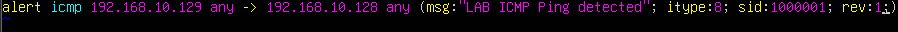
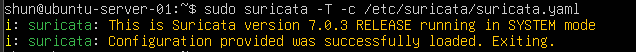
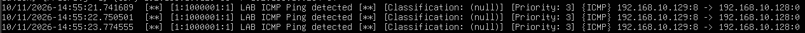

# Suricata Custom Rules

## 目的

Suricataの独自ルールを作成し、

- ルールの基本構文
- 自作ルールの読み込み
- 設定ファイルの検証
- ICMP通信の検知
- fast.logへのアラート出力

を確認する。

前回はSuricataがHTTP通信を自動解析することを確認した。

今回はさらに一歩進み、
自分で検知条件を定義し、
条件に一致した通信をアラートとして出力する。

## 環境

- Windows 11 Host
- VMware Workstation

### Kali Linux

    IPv4: 192.168.10.129

### Ubuntu Server 24.04 LTS

    IPv4: 192.168.10.128

### Lab Network

    192.168.10.0/24

SuricataはUbuntu Server上で動作させ、
`ens33` を監視する。

## 1. ルールファイル設定の確認

Suricataが読み込むルールファイルを確認した。

    sudo grep -n -A 10 "^rule-files:" /etc/suricata/suricata.yaml

結果、

    rule-files:
      - suricata.rules

となっていた。

また、
デフォルトのルールディレクトリを確認した。

    sudo grep -n "^default-rule-path:" /etc/suricata/suricata.yaml

結果、

    default-rule-path: /var/lib/suricata/rules

となっていた。

このため、
自作ルールもこのディレクトリ内に配置する。

## 2. local.rulesの作成

自作ルール用として、

    /var/lib/suricata/rules/local.rules

を作成した。

一般ユーザーでは書き込み権限がないため、
root権限で編集した。

    sudo nano /var/lib/suricata/rules/local.rules

以下のルールを1行追加した。

    alert icmp 192.168.10.129 any -> 192.168.10.128 any (msg:"LAB ICMP Ping detected"; itype:8; sid:1000001; rev:1;)

## 3. ルールの意味

今回作成したルールは以下の構造になっている。

    alert icmp 192.168.10.129 any -> 192.168.10.128 any (msg:"LAB ICMP Ping detected"; itype:8; sid:1000001; rev:1;)

それぞれの意味は次の通り。

    alert
    → 条件に一致した場合にアラートを出す

    icmp
    → ICMP通信を対象とする

    192.168.10.129
    → 送信元IPアドレス
    → Kali Linux

    any
    → ポート番号に関係しない

    ->
    → 左側から右側への通信を対象とする

    192.168.10.128
    → 宛先IPアドレス
    → Ubuntu Server

    msg:"LAB ICMP Ping detected"
    → アラートに表示するメッセージ

    itype:8
    → ICMP Type 8
    → Echo Request
    → ping要求を表す

    sid:1000001
    → ルールを識別するためのSignature ID

    rev:1
    → ルールのRevision番号

## 4. Suricataにlocal.rulesを追加

`/etc/suricata/suricata.yaml` の
`rule-files` に `local.rules` を追加した。

変更前：

    rule-files:
      - suricata.rules

変更後：

    rule-files:
      - suricata.rules
      - local.rules

これにより、
既存のSuricataルールに加えて
自作ルールも読み込まれる。

## 5. 設定ファイルのテスト

自作ルール追加後、
設定ファイルのテストを行った。

    sudo suricata -T -c /etc/suricata/suricata.yaml

結果、

    Configuration provided was successfully loaded. Exiting.

と表示された。

これにより、

- Suricata設定ファイル
- local.rules
- ルール構文

が正常に読み込めることを確認した。

## 6. Suricataの起動

Ubuntu ServerでSuricataを起動した。

    sudo suricata -c /etc/suricata/suricata.yaml -i ens33

別のターミナルで、
アラートログを監視した。

    sudo tail -f /var/log/suricata/fast.log

## 7. Kaliからpingを実行

Kali LinuxからUbuntu Serverへ
3回pingを送信した。

    ping -c 3 192.168.10.128

この通信は、

    Kali Linux
    192.168.10.129
        ↓
    ICMP Echo Request
        ↓
    Ubuntu Server
    192.168.10.128

という通信になる。

## 8. fast.logでアラート確認

Ubuntu Server側の `fast.log` に、

    LAB ICMP Ping detected

というアラートが表示された。

3回pingを送信したため、
アラートも3回記録された。

ログには、

    [1:1000001:1] LAB ICMP Ping detected

と表示されていた。

これは、

    Generator ID: 1
    Signature ID: 1000001
    Revision: 1

を表している。

また、

    ICMP 192.168.10.129:8 -> 192.168.10.128:0

と表示され、
KaliからUbuntuへのICMP通信であることも確認できた。

## 9. Classificationについて

今回のアラートでは、

    Classification: (null)

と表示された。

これは、
今回の自作ルールに `classtype` を指定していないためである。

また、

    Priority: 3

と表示された。

今回の目的は、
ルール条件に一致した通信を
実際にアラートとして検知できることを確認することなので、
今回は `classtype` の追加は行わなかった。

## 10. 今回の検知の流れ

今回の処理を整理すると、

    Kali Linux
        ↓
    ping
        ↓
    ICMP Echo Request
        ↓
    Ubuntu ens33
        ↓
    Suricata
        ↓
    local.rules
        ↓
    itype:8 に一致
        ↓
    alert
        ↓
    fast.log

という流れになる。

前回はSuricataが通信を自動解析することを確認した。

今回はさらに、

    自分で条件を定義
        ↓
    条件に一致
        ↓
    アラートを生成

というIDSの基本的な検知処理を確認できた。

## 学んだこと

- Suricataでは独自ルールを作成できる
- `local.rules` に自作ルールを保存できる
- `rule-files` にルールファイルを追加する必要がある
- `alert` は条件一致時にアラートを生成する
- `icmp` でICMP通信を対象にできる
- `itype:8` はICMP Echo Requestを表す
- `sid` はルールを識別するIDである
- `rev` はルールのRevision番号である
- `suricata -T` で自作ルールを含む設定を確認できる
- 条件に一致すると `fast.log` にアラートが記録される
- pingの回数に応じて複数回のアラートが発生する
- Suricataは通信解析だけでなくルールによる検知も行える

## Next

次回は、
複数ポートへの接続を利用して
ポートスキャン検知を行う。

これまでNmapで観察してきた、

    短時間に複数ポートへ通信する動作

をSuricataで検知し、

    Port Scan
        ↓
    Rule Match
        ↓
    Alert

という流れを確認する。

次の記録：

    03-port-scan-detection.md
