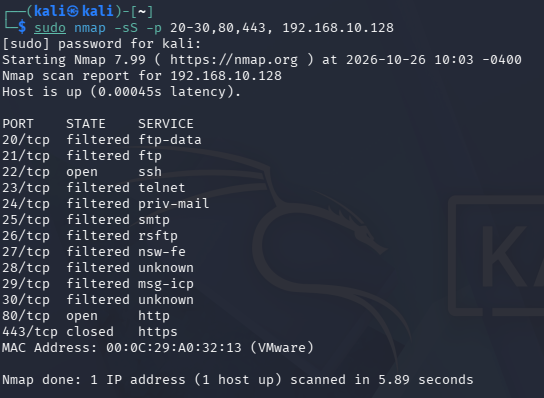
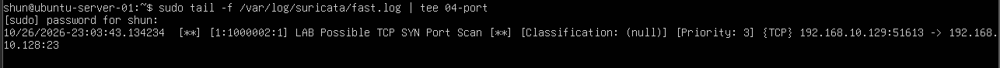

# Port Scan Detection with Suricata

## 目的

Kali LinuxからNmapによるSYNスキャンを実行し、
Ubuntu Server上のSuricataでポートスキャンを検知する。

今回の実験では、

- TCP SYNスキャン
- Suricata独自ルール
- threshold
- fast.log
- Nmap実行結果とIDS側の検知結果

を関連付けて確認する。

これまでの `02-port-scanning` では、
攻撃側・調査側としてNmapの通信を観察した。

今回は同じようなSYNスキャンを、
IDS側からどのように検知できるかを確認する。

## 環境

- Windows 11 Host
- VMware Workstation

### Kali Linux

    IPv4: 192.168.10.129

### Ubuntu Server 24.04 LTS

    IPv4: 192.168.10.128

### Lab Network

    192.168.10.0/24

SuricataはUbuntu Server上で動作させ、
`ens33` を監視する。

## 1. ポートスキャン検知ルールの作成

前回作成した、

    /var/lib/suricata/rules/local.rules

へ、
TCP SYNを一定回数以上検知するルールを追加した。

    alert tcp 192.168.10.129 any -> 192.168.10.128 any (msg:"LAB Possible TCP SYN Port Scan"; flags:S; flow:stateless; threshold:type both, track by_src, count 5, seconds 10; sid:1000002; rev:1;)

## 2. ルールの意味

今回のルールを分解すると、

    alert tcp

TCP通信が条件に一致した場合、
アラートを生成する。

    192.168.10.129 any

送信元はKali Linuxとする。

    ->

KaliからUbuntuへの通信を対象とする。

    192.168.10.128 any

宛先はUbuntu Serverとする。

    flags:S

TCP SYNフラグが設定されたパケットを対象とする。

これは、
新しいTCP接続を開始しようとするパケットである。

    flow:stateless

TCP接続が完全に成立していなくても、
個々のパケットを対象として判定する。

ポートスキャンでは、
接続が最後まで成立しない通信も多いため、
今回のルールではstatelessとして判定した。

    threshold:type both, track by_src, count 5, seconds 10

同じ送信元から送られるパケットを数え、

    10秒以内に5回

条件に一致した場合にアラートを生成する。

    track by_src

によって、
送信元IPアドレスごとに回数を追跡する。

    sid:1000002

今回の自作ルールを識別するSignature IDである。

    rev:1

このルールのRevision番号である。

## 3. ルール記述時のエラー

最初の設定テストでは、

    failed to parse address "192/168.10.129"

というエラーが発生した。

送信元IPアドレスを、

    192/168.10.129

と誤って記述していたことが原因だった。

正しく、

    192.168.10.129

へ修正した。

このようにSuricataでは、
ルールの構文やIPアドレスの記述に問題がある場合、
設定テスト時にエラーを確認できる。

## 4. 設定テスト

修正後、

    sudo suricata -T -c /etc/suricata/suricata.yaml

を実行した。

結果、

    Configuration provided was successfully loaded. Exiting.

と表示された。

これにより、
ポートスキャン検知ルールを含む設定が
正常に読み込まれることを確認した。

## 5. Suricataの起動

Ubuntu ServerでSuricataを起動した。

    sudo suricata -c /etc/suricata/suricata.yaml -i ens33

SuricataはHost-only Network側の
`ens33` を監視する。

## 6. アラートログの監視

Suricataのアラートログである、

    /var/log/suricata/fast.log

を監視した。

今回は、

    sudo tail -f /var/log/suricata/fast.log | tee 04-port

を使用した。

`tail -f` は、
`fast.log` に追記される内容を
リアルタイムで表示する。

`tee` を使用することで、

    画面へ表示

しながら、

    04-port

というファイルにも同じ内容を保存した。
04-port　という名前は今回の学習が4回目だと勘違いしたため04にしています。本当は　03-port　としたかったです。

処理の流れは、

    fast.log
        ↓
    tail -f
        ↓
       tee
      /   \
    画面   04-port

となる。

## 7. KaliからSYNスキャンを実行

Kali Linuxから、
Ubuntu Serverの複数ポートへSYNスキャンを実行した。

    sudo nmap -sS -p 20-30,80,443 192.168.10.128

結果、

    22/tcp  open
    80/tcp  open
    443/tcp closed

などが確認できた。

20番から30番までの多くのポートは、

    filtered

となっていた。

このスキャンでは、
短時間に複数の宛先ポートへ
TCP SYNパケットが送信される。

## 8. Suricataによる検知

Ubuntu Server側の `fast.log` に、

    LAB Possible TCP SYN Port Scan

というアラートが表示された。

ログには、

    [1:1000002:1] LAB Possible TCP SYN Port Scan

と記録されていた。

これは、

    Generator ID: 1
    Signature ID: 1000002
    Revision: 1

を表している。

また、

    192.168.10.129

から、

    192.168.10.128

へのTCP通信として検知された。

## 9. 検知の流れ

今回の実験を整理すると、

    Kali Linux
        ↓
    Nmap -sS
        ↓
    複数ポートへTCP SYN
        ↓
    Ubuntu ens33
        ↓
    Suricata
        ↓
    local.rules
        ↓
    flags:S
        ↓
    SYNパケットを検出
        ↓
    threshold
        ↓
    10秒以内に5回以上
        ↓
    alert
        ↓
    fast.log

という流れになる。

## 10. 前回のポートスキャン実験との違い

`02-port-scanning` では、
Kali側からNmapを実行し、

- open
- closed
- filtered
- SYN / SYN-ACK / RST
- 再送

などを観察した。

つまり、

    スキャンする側

の視点で通信を分析していた。

今回の実験では、

    スキャンされる側

にSuricataを配置し、

    短時間に複数のSYNが送られている

という特徴を利用して
ポートスキャンを検知した。

これにより、

    Nmapによる通信の仕組み

と、

    IDSによる検知

を関連付けて理解できた。

## 11. thresholdについて

今回のルールでは、

    count 5
    seconds 10

と設定した。

つまり、

    10秒以内に5回以上

という比較的低い条件である。

これは、
ラボ環境で確実に検知動作を確認するための設定である。

実際のネットワークでは、
正常な通信でも短時間に複数のSYNが発生する可能性がある。

そのため実運用では、

- 対象ネットワーク
- 通常の通信量
- サーバーの役割
- 誤検知
- 検知したいスキャン速度

などを考慮して
thresholdを調整する必要がある。

## 学んだこと

- NmapのSYNスキャンは複数ポートへSYNを送信する
- SuricataではTCP Flagsを条件として検知できる
- `flags:S` でSYNパケットを対象にできる
- `flow:stateless` で接続成立前のパケットも判定できる
- `threshold` で一定時間内の通信回数を条件にできる
- `track by_src` で送信元IPごとに通信回数を追跡できる
- 自作ルールによってポートスキャンを検知できる
- `fast.log` でアラートを確認できる
- `tee` を使うと画面表示とファイル保存を同時に行える
- ルール作成後は `suricata -T` で設定確認することが重要である
- IDSの検知条件は厳しすぎても緩すぎても問題になる
- スキャンする側と検知する側の両方から通信を理解できる

## Next

次回は、
SuricataがHTTPやTLS通信を
どのように解析・記録するかを確認する。

HTTPでは、

    Method
    URL
    User-Agent
    Status

などを確認する。

TLSでは、

    TLS Version
    Certificate
    SNI

など、
暗号化されていても取得できる情報を確認する。

次の記録：

    04-http-tls-events.md
